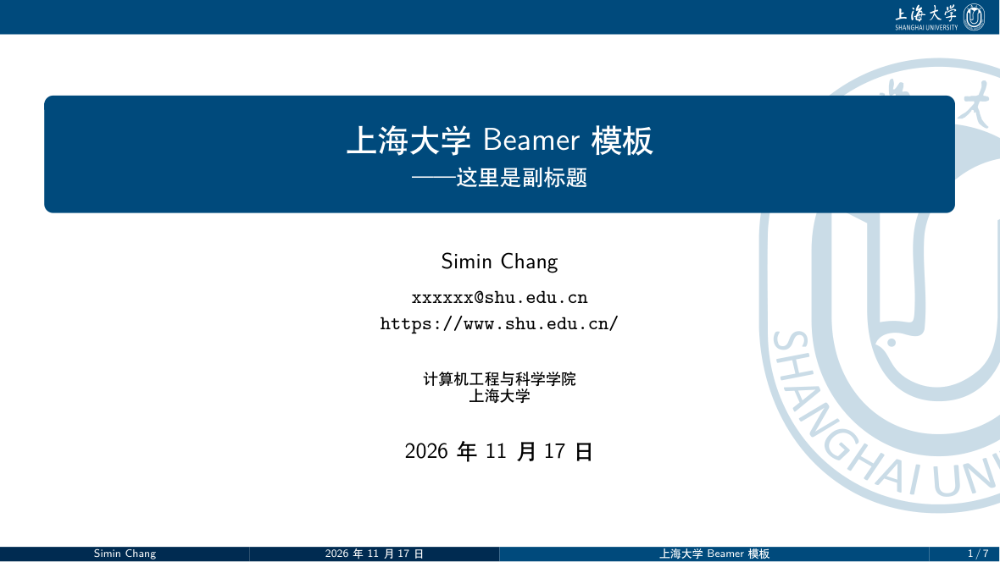
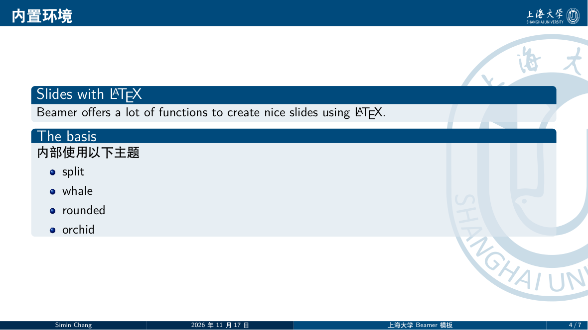

# 上海大学 Beamer 模板 · 校徽水印版

**Shanghai University Beamer Logo Template** · Simin Chang

[在 Overleaf 打开](https://www.overleaf.com/docs?snip_uri=https%3A%2F%2Fraw.githubusercontent.com%2FSiminChang%2FShanghai-University-SHU-Beamer-Logo-Template%2Fmain%2FSHU-Logo-Overleaf.zip&engine=xelatex&main_document=SHU_BeamerTemplate.tex) · [下载源码 ZIP](https://raw.githubusercontent.com/SiminChang/Shanghai-University-SHU-Beamer-Logo-Template/main/SHU-Logo-Overleaf.zip) · [完整示例 PDF](SHU_BeamerTemplate.pdf)

这是一套 16:9 的上海大学中英文演示模板。页首采用上大蓝（C100、M70、Y20、K20），左侧放本页标题，右侧放上海大学中英文校名与校徽。淡蓝色大校徽从页面右侧伸入，透过浅色内容框仍可辨认。

| 封面 | 内置环境示例 |
| :---: | :---: |
| [](SHU_BeamerTemplate.pdf) | [](SHU_BeamerTemplate.pdf) |

## 使用方法

**Overleaf**　点击页首的「在 Overleaf 打开」，或上传源码 ZIP。编译器选 **XeLaTeX**，主文件选 **SHU_BeamerTemplate.tex**。

**本地**　在含中文组件的 TeX Live 环境中，从工程根目录运行：

```sh
latexmk -xelatex SHU_BeamerTemplate.tex
```

## 修改内容

- `SHU_BeamerTemplate.tex` 包含封面信息和七页示例。修改 `\title`、`\author`、`\institute` 和 `\date` 即可替换标题、邮箱、网址、院系与日期，方括号内可填写页脚简称。
- `beamerthemeSHULogo.sty` 定义标题栏、信息栏、校徽位置和内容框样式。`pic/` 存放可放大投影的矢量标识。
- 内容框底色默认不透明度为 70%。在 `\usetheme{SHULogo}` 后添加 `\renewcommand{\SHUblockopacity}{0.55}`，即可让水印透出更多，文字仍保持不透明。
- 讲义沿用浙大模板的提纲、公式、内置块、带数字列表、结论与参考文献示例，可按需复制任意一页。

## 来源与许可

Simin Chang 根据 QiyuanChen 的浙江大学 Beamer 模板制作此上海大学版本，更换了学校标识和封面信息，重做标题栏及半透明内容框。模板及改编示例沿用 CC BY 4.0。学校名称、校徽和校名字标归上海大学所有。[原版 Overleaf 工程](https://www.overleaf.com/latex/templates/zhe-jiang-da-xue-beamer-mo-ban-zju-beamer-template/jhtfvynrcbrg) · [许可与署名](LICENSE) · [上海大学官网](https://www.shu.edu.cn/)
